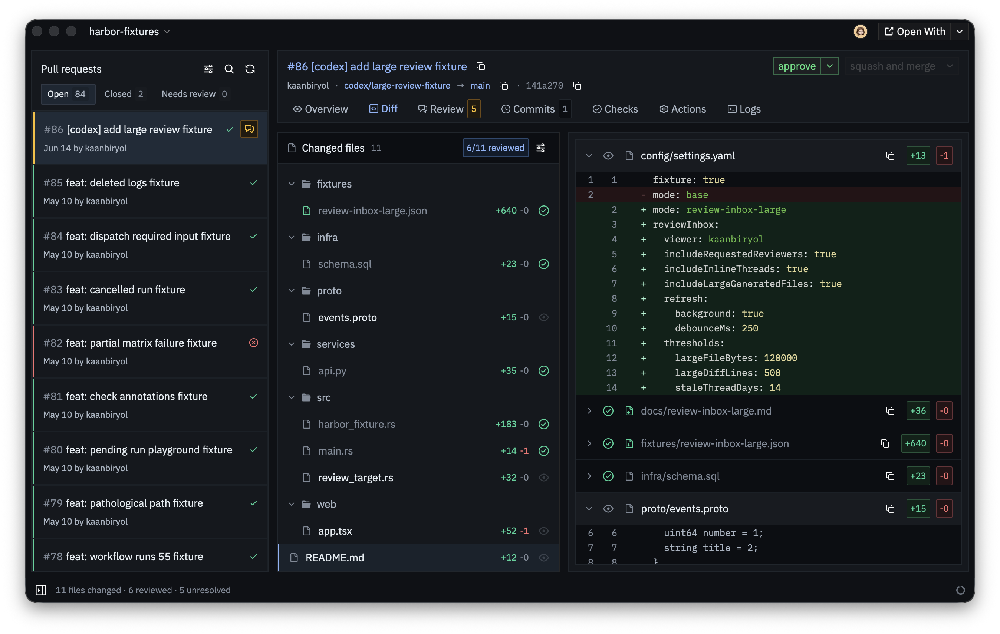

# Harbor



Harbor is a native Rust app for GitHub.com pull request workflows. It helps you review changes, track checks, inspect workflow logs and manage review threads.

It is designed for fast review workflows: repository switching, pull request
inboxes, changed file navigation, diff review threads, pending review
submission, workflow runs, logs, checks, local PR worktrees, and editor handoff.

## Status

Harbor is early software. The core app builds and has a growing test suite, but
it is not packaged for end-user installation yet.

Harbor is currently tested and supported on macOS only. Other platforms may
build, but they are not tested or supported yet.

## Requirements

- An Apple silicon Mac running macOS 14 Sonoma or later
- Rust `1.90` or newer
- A working Xcode toolchain for GPUI
- GitHub CLI, if you want to authenticate through `gh`

On Xcode versions that ship the Metal compiler as a downloadable component,
install it once before building Harbor:

```bash
xcodebuild -downloadComponent MetalToolchain
```

## Install

Harbor does not have a packaged macOS app release yet. The intended release path
is a zipped `Harbor.app` that can be copied into `/Applications`.

Until then, install the command-line launcher from source with Cargo:

```bash
cargo install --git https://github.com/kaanbiryol/harbor --locked --bin harbor harbor-app
```

Then run:

```bash
harbor
```

To build a local macOS app bundle:

```bash
script/package-macos
open target/macos/Harbor.app
```

The packaging script also creates
`target/macos/Harbor-0.1.0-macos-arm64.zip`. Harbor currently supports Apple
silicon Macs running macOS 14 Sonoma or later. The ZIP is the artifact that
should be attached to a GitHub release once app signing and release validation
are ready. Public macOS app releases should be signed and notarized before
publishing.

## Run From Source

```bash
cargo run -p harbor-app --bin harbor --locked
```

On first launch, Harbor asks you to connect GitHub.

The easiest path is GitHub CLI auth:

```bash
gh auth login
```

Then choose **Use GitHub CLI** in Harbor.

OAuth device login is also supported. Choose **Continue with GitHub** and Harbor
will open GitHub's device login flow in your browser.

The OAuth flow requests `repo` and `read:org` scopes. Harbor uses its built-in
public OAuth Client ID by default. To test a custom OAuth app, override it with:

```bash
HARBOR_GITHUB_OAUTH_CLIENT_ID=your_client_id cargo run -p harbor-app
```

## Development

Use focused checks while editing:

```bash
script/check -p harbor-ui
script/test -p harbor-domain
script/test -p harbor-ui --lib open_inbox_loads_and_enriches_twenty_five_rows_in_two_requests
script/test-core
```

`script/check` checks code and test targets without linking. `script/test-core`
runs the domain, Git, GitHub, logs, storage, and sync tests without building GPUI.
The changed-file tree and filtering tests live in `harbor-domain`.
`script/test` and `script/clippy` accept Cargo's package selection flags; without
package selection they cover the workspace.

Launch a development build with fewer language parsers:

```bash
script/dev
```

`script/dev`, `script/check`, `script/test`, and `script/clippy` disable the
`full-languages` default feature. They retain Bash, JavaScript, JSON, Markdown,
Rust, Swift, TOML, TSX, TypeScript, and YAML highlighting. Other languages render
as plain text. Add `--features full-languages` when working on another language.
Normal Cargo builds, installs, and `script/package-macos` retain all languages.

Development and test builds use line-table debug information for backtraces.
For full variable inspection in a debugger, set `CARGO_PROFILE_DEV_DEBUG=full`
(or `CARGO_PROFILE_TEST_DEBUG=full` for tests). Changing debug settings rebuilds
affected artifacts. GPUI's existing optimization settings are retained for smooth
development builds.

Run the full checks before handing off changes:

```bash
script/fmt
script/test --workspace --all-features
script/clippy --workspace --all-features -- -D warnings
```

The same checks run in CI. To run formatting in check mode:

```bash
script/fmt -- --check
```

## Workspace Layout

- `crates/app`: GPUI application entrypoint and startup wiring
- `crates/ui`: workspace UI, panels, commands, rendering, and interaction state
- `crates/domain`: stable app models independent from GitHub wire formats
- `crates/github`: GitHub REST/GraphQL clients, DTOs, pagination, and transports
- `crates/git`: local Git repository and worktree operations
- `crates/storage`: SQLite cache, recent repositories, and persisted UI state
- `crates/sync`: background refresh policy and inbox change detection
- `crates/logs`: GitHub Actions log parsing

## License

Harbor is licensed under the MIT License. See [LICENSE](LICENSE).

Third-party dependencies and bundled fonts are distributed under their own
licenses. See [THIRD_PARTY_NOTICES.md](THIRD_PARTY_NOTICES.md).
